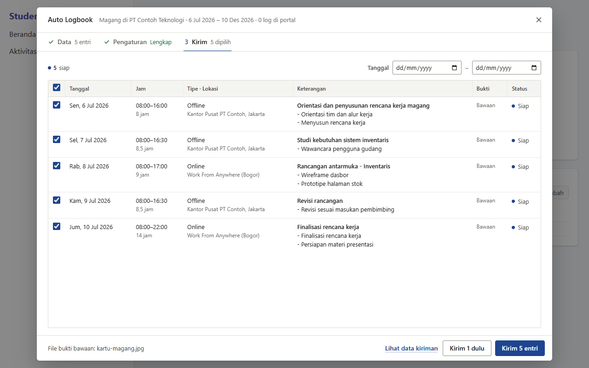
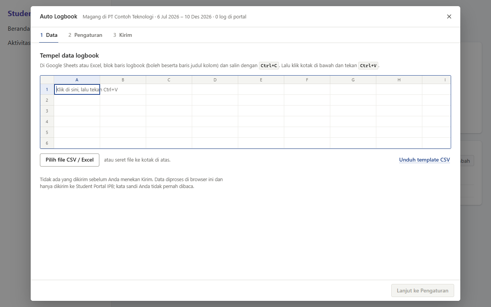
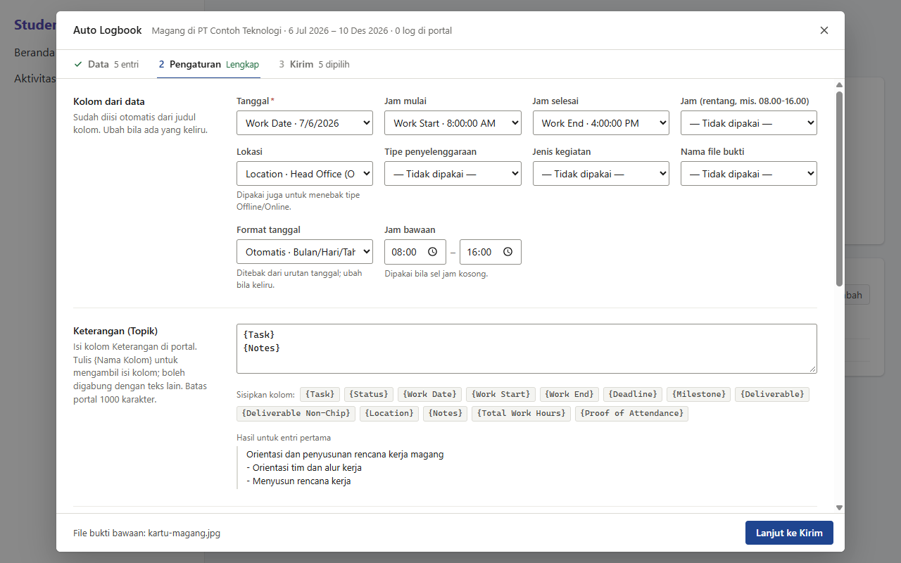
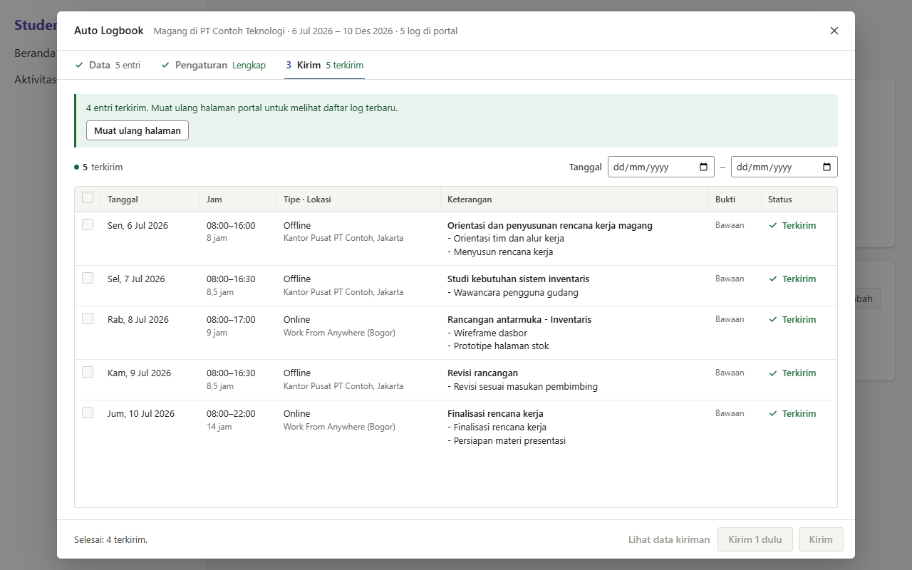

# Auto Logbook IPB

Ekstensi browser (Chrome/Edge) untuk mengisi **Log Aktivitas Kampus Merdeka** di Student Portal IPB sekaligus dari Google Sheets atau Excel. Tempel baris logbook Anda, periksa, lalu kirim. Tidak perlu lagi mengisi formulir "Tambah Log Aktivitas" satu per satu.

> **Ekstensi tidak resmi.** Tidak berafiliasi dengan IPB University. Gunakan untuk logbook Anda sendiri.



## Fitur

- **Tempel langsung dari spreadsheet.** Blok baris di Google Sheets/Excel, salin (Ctrl+C), lalu tempel (Ctrl+V). File CSV dan XLSX juga bisa dipakai.
- **Kolom dikenali otomatis.** Judul seperti *Tanggal*, *Jam Mulai*, *Keterangan*, *Lokasi*, *Work Date* atau *Task* langsung dipetakan, termasuk format tanggal 7/6/2026 vs 6/7/2026 dan jam seperti 8:00:00 AM.
- **Keterangan fleksibel.** Gabungkan beberapa kolom dengan template, misalnya `{Task}` lalu `{Notes}` di baris berikutnya.
- **Atur sekali, diingat seterusnya.** Tipe penyelenggaraan dan lokasi diatur per nilai kolom lokasi (mis. "WFA" → Online), sedangkan jenis kegiatan dan dosen penggerak dibaca dari formulir portal Anda.
- **Bukti aktivitas.** Satu file bukti bawaan untuk semua entri, atau file per tanggal yang dicocokkan otomatis dari nama file (mis. `IMG_20260706_144140.jpg`). Foto besar diperkecil sebelum diunggah.
- **Aman dari dobel.** Entri yang sudah ada di portal dilewati, dan setiap kiriman dicek muncul di daftar log.
- **Uji dulu.** "Lihat data kiriman" menampilkan isian formulir sebelum dikirim, dan "Kirim 1 dulu" mengirim satu entri sebagai percobaan.
- **Tanpa kata sandi.** Ekstensi bekerja di tab Student Portal yang sudah Anda buka dan tidak pernah membaca kata sandi.

## Pasang

### Dari Chrome Web Store

Belum tersedia.

### Manual (mode pengembang)

1. Unduh `auto-logbook-ipb-x.y.z.zip` dari halaman **Releases**, lalu ekstrak. Atau clone repositori ini dan pakai folder `extension/`.
2. Buka `chrome://extensions` (Edge: `edge://extensions`) dan aktifkan **Developer mode**.
3. Klik **Load unpacked**, lalu pilih folder yang berisi `manifest.json`.
4. Sematkan (pin) ikon Auto Logbook di toolbar agar mudah dibuka.

## Cara pakai

1. Login ke [Student Portal](https://studentportal.ipb.ac.id), buka **Kemahasiswaan › Aktivitas**, lalu klik **Log** pada kegiatan Anda. Mengklik ikon Auto Logbook di toolbar juga membuka halaman Aktivitas.
2. Klik tombol **Isi Otomatis** di samping tombol **Tambah**.
3. **Data.** Di Google Sheets/Excel, blok baris logbook (boleh beserta baris judul kolom), tekan Ctrl+C, lalu tempel di kotak dengan Ctrl+V.
4. **Pengaturan** (cukup sekali). Periksa pemetaan kolom dan template keterangan, pilih jenis kegiatan dan dosen penggerak, atur lokasi/tipe, lalu pilih file bukti.
5. **Kirim.** Periksa daftar entri. Klik **Kirim 1 dulu**, pastikan hasilnya benar di portal, lalu klik **Kirim N entri**.

Untuk minggu berikutnya cukup buka halaman Log, klik **Isi Otomatis**, tempel baris baru, lalu **Kirim**. Baris yang sudah terkirim otomatis dilewati.

| 1. Tempel data | 2. Pengaturan | 3. Hasil |
| --- | --- | --- |
|  |  |  |

## Format data

Tidak perlu format khusus; logbook yang sudah ada biasanya langsung terbaca. Judul kolom yang dikenali (tidak peka huruf besar/kecil):

| Isian portal | Contoh judul kolom |
| --- | --- |
| Tanggal | Tanggal, Tgl, Date, Work Date, Hari/Tanggal |
| Waktu kegiatan | Jam Mulai + Jam Selesai, Mulai + Selesai, Start + End, Work Start + Work End, atau satu kolom Jam berisi `08.00-16.00` |
| Keterangan | Keterangan, Topik, Kegiatan, Uraian, Deskripsi, Task (bisa ditambah Notes/Catatan/Rincian) |
| Lokasi | Lokasi, Tempat, Location |
| Tipe penyelenggaraan | Tipe, Mode, Metode, Online/Offline, Daring/Luring |
| Jenis kegiatan | Jenis, Jenis Kegiatan, Berita Acara, Kategori |
| Bukti | Bukti, File, Lampiran (berisi nama file) |

- **Tanggal:** `06/07/2026`, `6 Juli 2026`, `Senin, 6 Juli 2026`, `2026-07-06`, atau sel tanggal Excel. Urutan hari/bulan dideteksi otomatis dan bisa diubah di Pengaturan.
- **Jam:** `08:00`, `8.00`, `8:00:00 AM`, `16.30 WIB`.
- Baris tanpa tanggal dan keterangan (mis. baris total) dilewati.
- Belum punya logbook? Klik **Unduh template CSV** di panel.

## Privasi dan keamanan

- Ekstensi hanya berjalan di `studentportal.ipb.ac.id` dan hanya mengirim data ke sana, memakai sesi login Anda sendiri.
- Tidak ada server, analitik, atau layanan pihak ketiga.
- Pengaturan, data tempelan terakhir, file bukti bawaan, dan riwayat kiriman disimpan di penyimpanan lokal browser. Semuanya bisa dihapus dari panel atau dengan menghapus ekstensi.
- Kata sandi tidak pernah dibaca atau disimpan.

Selengkapnya di [PRIVACY.md](PRIVACY.md).

## Jika ada masalah

- **Pesan dari portal** (mis. "Tanggal di luar periode kegiatan") ditampilkan di kolom Status. Perbaiki datanya, lalu kirim lagi.
- **Sesi habis:** login ulang di Student Portal, buka lagi halaman Log, lalu kirim. Entri yang sudah terkirim tidak akan dikirim ulang.
- **Formulir tidak terbaca** (biasanya karena tampilan portal berubah): buka **Pengaturan › Lanjutan › Salin info teknis**, lalu tempelkan di issue baru. Info ini hanya berisi struktur formulir, tanpa token atau isi logbook.

## Pengembangan

Tanpa dependensi dan tanpa proses build: folder `extension/` langsung bisa dimuat ke Chrome.

```text
extension/
  manifest.json        Manifest V3
  background.js        tombol toolbar
  src/ns.js            utilitas bersama
  src/dates.js         parser tanggal & jam
  src/tabular.js       parser tempelan/CSV
  src/xlsx.js          pembaca .xlsx (tanpa library)
  src/mapping.js       pemetaan kolom & pembentukan entri
  src/portal.js        membaca formulir/daftar log dan mengirim entri
  src/store.js         penyimpanan & file
  src/styles.js        tampilan panel
  src/ui.js            panel
  src/content.js       titik masuk content script
test/unit/             unit test (node:test)
test/e2e/              uji end-to-end di Chrome headless
test/mock-portal/      tiruan Student Portal untuk e2e dan demo
tools/                 CDP client, demo, pembuat ikon, pembuat zip
```

| Perintah | Fungsi |
| --- | --- |
| `npm test` | Unit test (Node 22+) |
| `npm run e2e` | Memuat ekstensi asli di Chrome headless dan mengujinya terhadap tiruan Student Portal lokal. Butuh Chrome dan `openssl`. Tidak ada request ke portal sungguhan. |
| `npm run demo` | Membuka jendela Chrome biasa dengan ekstensi terpasang di tiruan Student Portal lokal, beserta contoh logbook dan file bukti, untuk dicoba langsung. Tutup jendelanya atau tekan Ctrl+C untuk berhenti. Butuh Chrome dan `openssl`. |
| `npm run icons` | Membuat ulang ikon PNG (desainnya ada di `tools/make-icons.mjs`) |
| `npm run pack` | Membuat `dist/auto-logbook-ipb-<versi>.zip` untuk Chrome Web Store |

## Terima kasih

Terinspirasi oleh [ipb_auto_logbook](https://github.com/insanansharyrasul/ipb_auto_logbook), [IPB-Student-Portal-Logbook-Bot](https://github.com/Anro128/IPB-Student-Portal-Logbook-Bot), dan [Auto-Logbook-IPB](https://github.com/nauraagb/Auto-Logbook-IPB). Kode di repositori ini ditulis terpisah.

## Lisensi

[MIT](LICENSE). Pastikan isi logbook yang Anda kirim sesuai dengan kegiatan yang benar-benar dilakukan, dan periksa hasilnya di portal.
